<picture>
  <source media="(prefers-color-scheme: dark)" srcset="assets/dark/header.svg">
  
</picture>

<picture>
  <source media="(prefers-color-scheme: dark)" srcset="assets/dark/typing.svg">
  
</picture>

 

<picture>
  <source media="(prefers-color-scheme: dark)" srcset="assets/dark/divider.svg">
  
</picture>

<picture>
  <source media="(prefers-color-scheme: dark)" srcset="assets/dark/title-about.svg">
  
</picture>

Full-stack developer from Bogor, Indonesia. I build web apps, CLI tools, and small AI agents, usually with Laravel, Next.js, or Python, depending on what the job actually needs.

- **Focus:** product backends, dashboards, and the occasional developer tool
- **Approach:** clean structure, small features that ship, and not over-engineering the boring parts

<picture>
  <source media="(prefers-color-scheme: dark)" srcset="assets/dark/divider.svg">
  
</picture>

<picture>
  <source media="(prefers-color-scheme: dark)" srcset="assets/dark/title-stack.svg">
  
</picture>

<b>Backend</b> 

<b>Frontend</b> 

<b>Database & data</b> 

<b>Auth & integrations</b> 

<b>Tooling</b> 

<picture>
  <source media="(prefers-color-scheme: dark)" srcset="assets/dark/divider.svg">
  
</picture>

<picture>
  <source media="(prefers-color-scheme: dark)" srcset="assets/dark/title-projects.svg">
  
</picture>

<a href="https://github.com/mhmdrzkyystiawnn/avunel-agent">
<picture>
  <source media="(prefers-color-scheme: dark)" srcset="assets/dark/card-avunel.svg">
  
</picture>
</a>
<a href="https://github.com/mhmdrzkyystiawnn/faktura">
<picture>
  <source media="(prefers-color-scheme: dark)" srcset="assets/dark/card-faktura.svg">
  
</picture>
</a>
<a href="https://github.com/mhmdrzkyystiawnn/library-connect">
<picture>
  <source media="(prefers-color-scheme: dark)" srcset="assets/dark/card-library-connect.svg">
  
</picture>
</a>
<a href="https://github.com/mhmdrzkyystiawnn/portofolio">
<picture>
  <source media="(prefers-color-scheme: dark)" srcset="assets/dark/card-portfolio.svg">
  
</picture>
</a>
<a href="https://github.com/mhmdrzkyystiawnn/tools-ai-recap-work-summary">
<picture>
  <source media="(prefers-color-scheme: dark)" srcset="assets/dark/card-pkl-jurnal.svg">
  
</picture>
</a>
<a href="https://github.com/mhmdrzkyystiawnn/cleaning-service">
<picture>
  <source media="(prefers-color-scheme: dark)" srcset="assets/dark/card-cleaning-service.svg">
  
</picture>
</a>

<picture>
  <source media="(prefers-color-scheme: dark)" srcset="assets/dark/divider.svg">
  
</picture>

<picture>
  <source media="(prefers-color-scheme: dark)" srcset="assets/dark/title-other.svg">
  
</picture>

> I also work on internal / internship projects (facility management, metering, patrol, etc.). These are not public and are owned together with the rest of the team, so I won't list them here.

<picture>
  <source media="(prefers-color-scheme: dark)" srcset="assets/dark/divider.svg">
  
</picture>

<picture>
  <source media="(prefers-color-scheme: dark)" srcset="assets/dark/title-contact.svg">
  
</picture>

 

<picture>
  <source media="(prefers-color-scheme: dark)" srcset="assets/dark/footer.svg">
  
</picture>
