 

Full-stack developer from Bogor, Indonesia. I build web apps, CLI tools, and small AI agents, usually with Laravel, Next.js, or Python, depending on what the job actually needs.

- **Focus:** product backends, dashboards, and the occasional developer tool
- **Approach:** clean structure, small features that ship, and not over-engineering the boring parts
- **Tinkering with:** agent frameworks and small utilities that save me an hour a week

<b>Backend</b> 

<b>Frontend</b> 

<b>Database & data</b> 

<b>Auth & integrations</b> 

<b>Tooling</b> 

<table>
  <tr>
    <td valign="top" width="50%">
      <h3><a href="https://github.com/mhmdrzkyystiawnn/avunel-agent">Avunel</a></h3>
      <b>A multi-agent AI assistant</b>
      
Python CLI for orchestrating AI agents with skills, plugins, scheduled jobs, and conversation memory. Cross-platform (bash, fish, PowerShell).

      

      

    </td>
    <td valign="top" width="50%">
      <h3><a href="https://github.com/mhmdrzkyystiawnn/faktura">Faktura</a></h3>
      <b>Invoicing monorepo</b>
      
NestJS 11 + Prisma 8 API and a Next.js 16 client in a pnpm monorepo. Argon2 + Google OAuth (Passport), Radix UI + TanStack on the front, Resend for email. Built to ship serverless on Neon.

      

      

    </td>
  </tr>
  <tr>
    <td valign="top" width="50%">
      <h3><a href="https://github.com/mhmdrzkyystiawnn/library-connect">Library Connect</a></h3>
      <b>School library booking system</b>
      
Laravel 12 app for a single school: students browse and book, an admin approves bookings, tracks loans, and records late-return fines. Stock is enforced server-side; the admin can set a different approved duration than requested.

      

      

    </td>
    <td valign="top" width="50%">
      <h3><a href="https://github.com/mhmdrzkyystiawnn/portofolio">Portfolio site</a></h3>
      <b>This site</b>
      
Next.js 16 App Router with all content in JSON files at build time, so adding a project is a single commit. The contact form uses Resend and Upstash Redis for per-IP rate limiting.

      

      

    </td>
  </tr>
  <tr>
    <td valign="top" width="50%">
      <h3><a href="https://github.com/mhmdrzkyystiawnn/tools-ai-recap-work-summary">PKL Jurnal Generator</a></h3>
      <b>Daily work journal from git</b>
      
Reads today's git log + diff across multiple projects, sends the relevant code to Gemini, and appends a daily summary to a weekly journal. Skips re-generation on the same day, with a --force flag when needed.

      

      

    </td>
    <td valign="top" width="50%">
      <h3><a href="https://github.com/mhmdrzkyystiawnn/cleaning-service">Cleaning Service</a></h3>
      <b>Booking platform</b>
      
Laravel 13 + Breeze web app for a cleaning business: public landing and catalog, customer booking flow, and an admin panel for packages, bookings, and FAQ.

      

      

    </td>
  </tr>
</table>

> I also work on internal / internship projects (facility management, metering, patrol, etc.). These are not public and are owned together with the rest of the team, so I won't list them here.

 

